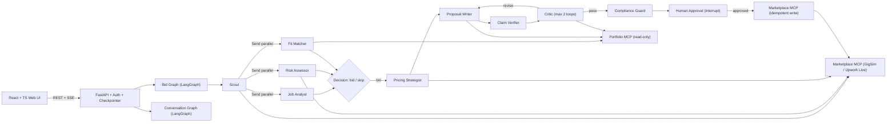

# GigBid Architecture (`docs/ARCHITECTURE.md`)

## 1. System Overview
GigBid separates **State** (current job/conversation working memory), **Execution Trace** (append-only audit log of every tool, model, token, cost, and latency), and **Long-Term Memory** (explicitly promoted `style_memory` and `outcome_memory` in LangGraph Store).

## 2. Why Each Agent Exists
- **Scout**: Polls saved searches politely within rate limits and deduplicates jobs.
- **Job Analyst**: Isolates untrusted job posts in `<untrusted_job_post>` delimiters and extracts typed `JobSpec`.
- **Risk Assessor**: Queries client history and flags scams, unpaid trials, off-platform requests, and prompt injections.
- **Fit Matcher**: Queries Portfolio MCP (`search_evidence`, `list_skills`) to build a requirement-to-evidence matrix.
- **Pricing Strategist**: Computes fair bid bands from 1,500 historical jobs + Nov 2 Connects surcharge (+4 Connects > $500).
- **Proposal Writer**: Drafts personalized proposals citing `[evidence_id]` while applying learned `style_memory`.
- **Claim Verifier**: Splits drafts into atomic sentences and strips/rewrites unsupported claims before Critique.
- **Critic**: Verifies grounding, personalisation, and the 1,800-char policy cap (max 2 revisions).
- **Compliance Guard**: Blocks off-platform contact/payment, guarantees, and masks PII.
- **Client Liaison**: Classifies client reply intent, proposes free calendar slots via Workspace MCP, and gates sends behind `interrupt()`.
